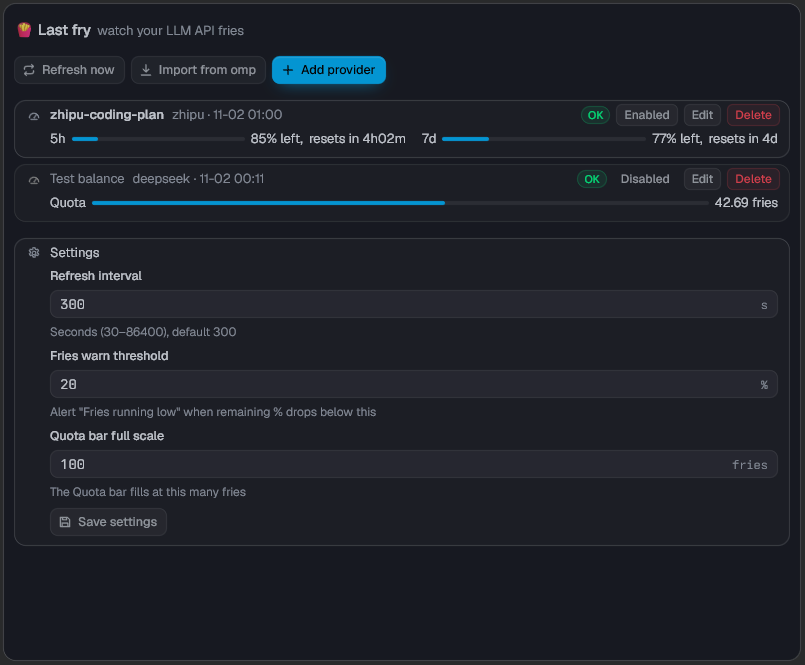
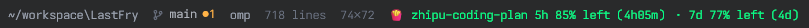

# 🍟 Last fry

A [Tern](https://docs.stencil.so/tern/) terminal plugin that monitors your LLM API quota ("fries") — a live statusline segment plus a manage block with one card per provider.

_How this project got its name:_

> *I was going to go get some fries on the pier.*
> *You'd better hurry. Someone's down to the last fry.*
> *The last fry?! How do you know?*
> *I ate it. 🍟*


_Manage block: one card per provider with per-window progress bars._


_Status line: a live 🍟 segment per provider._

## Install

```sh
tern plugin install github.com/KinseyD/LastFry
```

(or paste the repo URL in Tern's plugin settings).

Palette commands (group "Last fry"):

| Command | Action |
| --- | --- |
| `plugin.last-fry.refresh` | Refresh fries quota now |
| `plugin.last-fry.manage` | Open the fries manager |
| `plugin.last-fry.import_omp` | Import providers from omp |

Fastest setup: **one-click import from [omp](https://github.com/can1357/oh-my-pi)** — it maps your omp credentials to providers and seals the API keys straight into the system keychain. You can also add providers manually in the manage block (name, type, optional baseUrl, API key).

Keys live in your system keychain; one caveat: a key typed into the form briefly transits the plugin's kv before it is sealed — prefer omp import if that matters to you.

## Supported providers

DeepSeek · OpenRouter · SiliconFlow · Kimi · Zhipu/Z.ai · MiniMax · Novita · StepFun · Sub2API relays

Pay-as-you-go accounts show their balance in "fries"; plan accounts show 5h/7d windows.

## Settings

- Refresh interval (default 300 s)
- Warn threshold for remaining quota (default 20%)
- Quota bar full scale in fries (default 100)

## Develop

```sh
tern plugin link .
```

Edit and save — hot reload applies changes within ~300 ms. See [AGENTS.md](AGENTS.md) for architecture and contributing.
